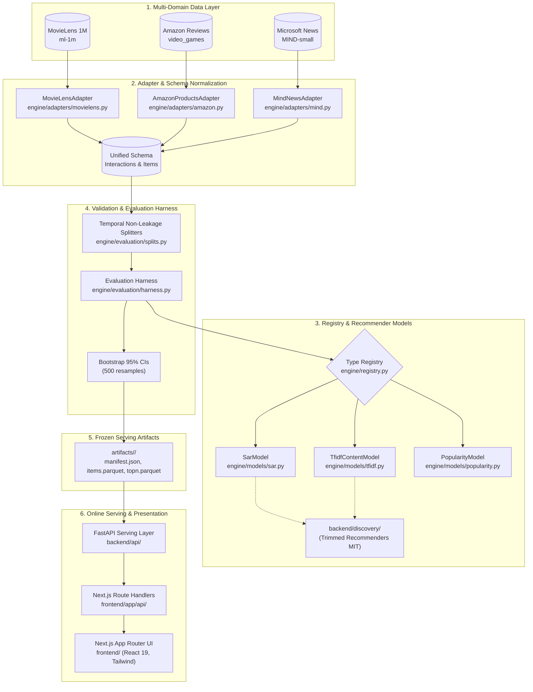
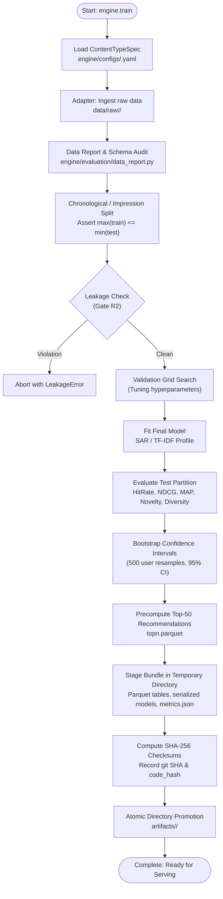
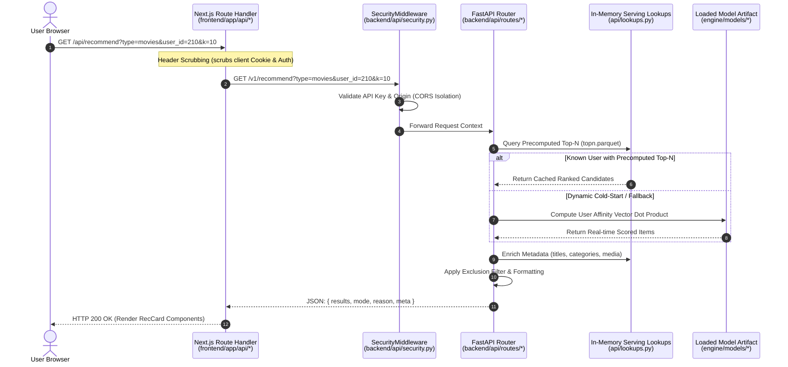
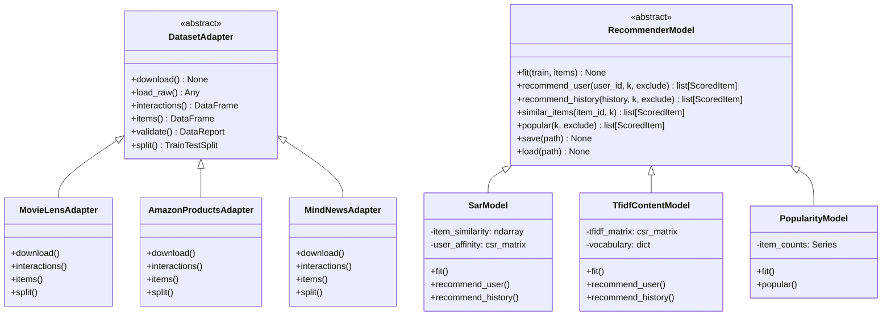
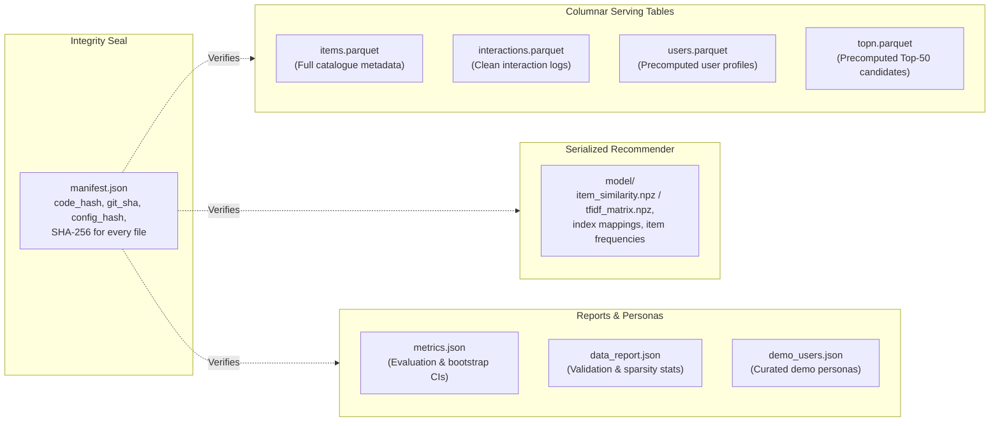

# System Architecture & Technical Design

The **Discovery Engine** is an extensible, CPU-optimized multi-domain recommender system. It serves three distinct content domains—**Movies** (collaborative, explicit ratings), **Products** (e-commerce, sparse long-tail catalog), and **Articles** (news, ephemeral content with 24-hour freshness)—from a single unified pipeline architecture.

---

## 1. System Overview Architecture

The architecture decouples offline training, reproducible artifact serialization, and online serving into isolated layers:



---

## 2. Training Pipeline Lifecycle

The training workflow (`python -m engine.train`) runs end-to-end with mathematical determinism and strict data leakage prevention:



---

## 3. Serving & Request Flow

The FastAPI serving service loads frozen artifacts into memory at boot and executes low-latency recommendations via pure CPU vectorized operations:



---

## 4. Adapter & Model Registry Architecture

The engine uses abstract base classes and runtime registration decorators (`@register_adapter`, `@register_model`) allowing content domains and algorithms to be added without modifying core framework code:



---

## 5. Artifact Layout & Cryptographic Integrity

Every content domain outputs a sealed, self-verifying artifact directory (`artifacts/<type>/`):



---

## 6. How the Engine Adapts to Content Types

<!-- GENERATED:adapts_table:START -->
| Domain Dimension | Movies | Products | Articles |
|---|---|---|---|
| **Source Dataset** | MovieLens 1M (`ml-1m`) | Amazon Video Games 5-core | Microsoft News Dataset (`MIND-small`) |
| **Catalog Scale** | ~3,700 movies | ~50,000 items (capped to top 8,000) | ~65,000 news articles |
| **User Signal** | Explicit rating (scale 1–5) | Explicit rating (scale 1–5) | Implicit click (binary 0/1) |
| **Positive Threshold** | Rating $\ge 4.0$ | Rating $\ge 4.0$ | Click = 1 |
| **Temporal Dynamics** | Multi-year consumption lifespan | Long-tail catalog lifetime | Ephemeral (recency window = 24h) |
| **Split Strategy** | Chronological (80/20 per user) | Chronological (80/20 per user) | Impression timestamp split |
| **Recommender Model** | SAR (Item-Item Jaccard co-occurrence) | SAR (Popularity-capped co-occurrence) | TF-IDF User Profile Cosine Matching |
| **Repeat Consumption** | Prohibited (`allow_repeat: false`) | Prohibited (`allow_repeat: false`) | Prohibited (`allow_repeat: false`) |
| **Cold-Start Policy** | SAR affinity vector product | SAR affinity vector product | Profile vector centroid cosine similarity |
| **UI Presentation** | Movie poster & year card | Product image, price & brand card | Headline, category & recency card |
<!-- GENERATED:adapts_table:END -->

---

## 7. REST API Endpoints Specification

<!-- GENERATED:endpoints_table:START -->
| Method | Endpoint Path | Summary | Description |
|---|---|---|---|
| `GET` | `/v1/about` | Get About | Attribution, dataset citations, and original vs derived transformations. |
| `GET` | `/v1/health` | Get Health | System health check: reports overall and per-type serving status. |
| `GET` | `/v1/items/search` | Search Items | Execute normalized text search with exact > prefix > word-start > contains ranking. |
| `GET` | `/v1/items/{item_id}` | Get Item Detail | Retrieve complete metadata and details for a single catalogue item. |
| `GET` | `/v1/metrics` | Get Metrics | Retrieve verified evaluation metrics, cold-start degradation curves, and provenance. |
| `GET` | `/v1/popular` | Get Popular | Return top-k overall popular items for content type. |
| `GET` | `/v1/recommend` | Get Recommendations | Serve personalized recommendations from precomputed topn.parquet when possible, or compute live. |
| `POST` | `/v1/recommend/cold-start` | Recommend Cold Start | Generate recommendations from hypothetical user history (cold-start). |
| `GET` | `/v1/similar` | Get Similar | Return top-k items similar to query item. |
| `GET` | `/v1/types` | Get Types | List registered content types with dataset statistics and UI configuration. |
| `GET` | `/v1/types/{type}/users` | Get Users For Type | Retrieve users for exploration: diverse demo users appear first, followed by sampled users. |
| `GET` | `/v1/users/{user_id}/profile` | Get User Profile | Retrieve user taste profile: interaction counts, category preferences, and recent history. |
<!-- GENERATED:endpoints_table:END -->

---

## 8. Canonical `metrics.json` Schema

The offline evaluation harness produces a machine-readable `metrics.json` stored in `artifacts/<type>/metrics.json`:

```json
{
  "protocol": {
    "split_strategy": "chronological",
    "split_ratio": 0.8,
    "allow_repeat": false,
    "positive_threshold": 4.0,
    "total_interactions": 999611,
    "total_items": 3416,
    "evaluated_test_users": 1918,
    "total_test_users": 2000,
    "bootstrap_resamples": 500,
    "bootstrap_ci": 0.95
  },
  "seeds": {
    "split_seed": 42,
    "model_seed": 42
  },
  "config_hash": "e26bc6e7...",
  "git_sha": "5ee87454...",
  "code_hash": "d8271011...",
  "content_type": "movies",
  "dataset_variant": "1m",
  "k_values": [5, 10, 20],
  "models": {
    "sar": {
      "10": {
        "precision": 0.0521,
        "precision_ci95": [0.0463, 0.0578],
        "recall": 0.0568,
        "recall_ci95": [0.0504, 0.0632],
        "ndcg": 0.0718,
        "ndcg_ci95": [0.0645, 0.0791],
        "map": 0.0345,
        "map_ci95": [0.0298, 0.0392],
        "hit_rate": 0.2852,
        "hit_rate_ci95": [0.2648, 0.3056],
        "coverage": 0.3842,
        "novelty": 9.1245,
        "diversity": 0.8412,
        "personalisation": 0.9234
      }
    },
    "popularity": {
      "10": { ... }
    },
    "random": {
      "10": { ... }
    }
  }
}
```

---

## 9. Deliberate Architectural Omissions

To guarantee mathematical auditability, reproducible evaluation, and strict security isolation, the following components are **deliberately omitted**:
1. **No User Accounts / Sessions in Database:** The system maintains zero stateful database connections or user auth tables. Users are selected from pre-computed personas or cold-started via stateless history payloads.
2. **No Deep-Learning Runtimes:** The online serving application imports zero deep-learning libraries (`torch`, `tensorflow`). Serving runs purely on Python standard library, NumPy, and SciPy sparse math.
3. **No Online Learning / In-Flight Weight Updates:** Serving models are strictly immutable. Online learning introduces catastrophic forgetting, non-reproducibility, and data drift vulnerability. Model updates occur exclusively via offline batch pipelines.
4. **No LLM in the Serving Loop:** Recommendations, explanations, and similarity rankings are calculated via deterministic collaborative filtering and content vectors, eliminating hallucinations and high latency.

---

## 10. Extensibility & Core-Unchanged Verification

Adding a new content domain (such as Books or Podcasts) requires only:
1. Authoring a new `DatasetAdapter` subclass under `backend/engine/adapters/`.
2. Authoring a configuration file under `backend/engine/configs/<domain>.yaml`.
3. Registering the adapter with `@register_adapter("<domain>")`.

All core abstractions—including the training supervisor, temporal splitter, bootstrap confidence interval evaluator, artifact verification, FastAPI routing, and Next.js card components—remain completely untouched.

This architectural guarantee is verified continuously by `python tools/core_unchanged.py`:
```
[SUCCESS] Core Unchanged Check PASSED.
Zero core engine abstractions were modified across content type additions.
```
